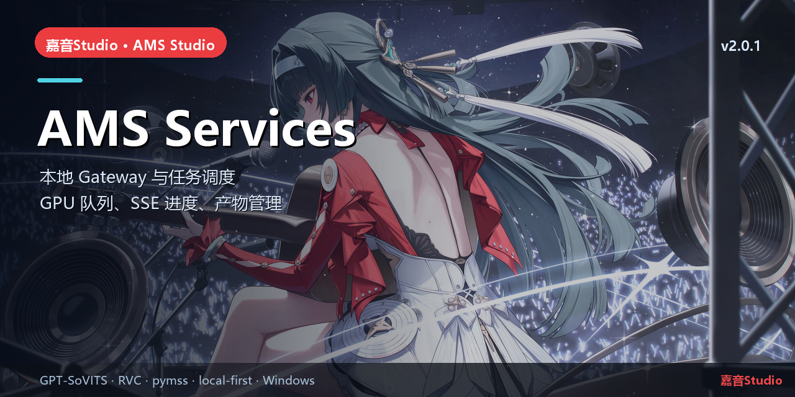

# AMS Services

> 本地 Gateway · GPU 任务队列 · SSE 进度 · 产物管理


## 简介

嘉音Studio 的本地服务层：**FastAPI Gateway + SQLite + SSE**，统一调度 RVC、pymss、GPT-SoVITS、MSVC、混音与评测任务。
Gateway 只监听 `127.0.0.1`，使用 Bearer token；任务串行 GPU 队列，产物写入安装目录 `data/artifacts/`。

## 核心能力

- 作业类型：`convert.rvc`、`separate.pymss`、`train.rvc`、`mix.master`、`evaluate.audio`、MSVC 转换。
- TTS：`tts.dataset.prepare.gsv`、`tts.train.gsv`、`tts.synthesize.gsv`（V5turbo 48 kHz）。
- 实时进度：SSE 事件、取消/重试、GPU 串行与资源锁。
- 独立服务：`tts-gsv-service/`（GPT-SoVITS headless）、`vc-service/`（实时变声）。

## 本仓库

```text
gateway/            FastAPI 应用、jobs、runners、API、测试
tts-gsv-service/    GPT-SoVITS 合成/训练 headless 服务
vc-service/         实时变声服务
experiments/        基准与冒烟脚本
```

## 快速开始

```powershell
cd gateway
python -m venv .venv
.venv\Scripts\pip install -r requirements.txt
.venv\Scripts\python -m app --ams-home F:\AMS-Studio\data --port 0
```

## 相关链接

- 总仓库：[yan-mc/AMS-Studio](https://github.com/yan-mc/AMS-Studio)
- 最新发布：[yan-mc/ams-release releases](https://github.com/yan-mc/ams-release/releases)
- 当前版本：**嘉音Studio v2.0.1**（feed 2058）
- 文档：[ams-docs](https://github.com/yan-mc/ams-docs)

## 说明

- 所有音乐数据默认留在安装目录 `data/`；Gateway 只监听 `127.0.0.1`。
- 本项目为本地优先工具，不提供云端上传；使用第三方模型/音频时请遵守各自许可。
- License: MIT (see `LICENSE`).
